# CloudVault AI — Technical Documentation

> Local-first document management built on the Go-Store backend: Go/Gin, PostgreSQL + pgvector, private local storage, and an optional FastAPI/Ollama ingestion service. Cloud storage adapters exist, but Phase 2 ingestion currently supports local storage only.

The registered route contract is maintained in [`docs/openapi.yaml`](docs/openapi.yaml). Sections 1–14 describe the Go backend foundation; Section 15 records current ingestion, summaries, retrieval, and limits; Section 16 is the RAG/frontend design-only plan.

---

## Table of Contents

1. [Overview](#1-overview)
2. [Architecture](#2-architecture)
   - 2.1 [High-Level System Diagram](#21-high-level-system-diagram)
   - 2.2 [Internal Package Structure](#22-internal-package-structure)
   - 2.3 [Dependency Injection Chain](#23-dependency-injection-chain)
3. [Data Model](#3-data-model)
   - 3.1 [Entity-Relationship Diagram](#31-entity-relationship-diagram)
   - 3.2 [Table Definitions](#32-table-definitions)
4. [Authentication & Security](#4-authentication--security)
   - 4.1 [JWT Token Derivation](#41-jwt-token-derivation)
   - 4.2 [Request Authentication Flow](#42-request-authentication-flow)
   - 4.3 [Password Hashing](#43-password-hashing)
5. [API Reference](#5-api-reference)
   - 5.1 [Auth Endpoints](#51-auth-endpoints)
   - 5.2 [User Endpoints](#52-user-endpoints)
   - 5.3 [File Endpoints](#53-file-endpoints)
   - 5.4 [Health Check](#54-health-check)
   - 5.5 [Error Response Shape](#55-error-response-shape)
6. [Request / Response Flows](#6-request--response-flows)
   - 6.1 [Register & Login](#61-register--login)
   - 6.2 [File Upload](#62-file-upload)
   - 6.3 [File Delete](#63-file-delete)
7. [Storage Layer](#7-storage-layer)
   - 7.1 [Storage Interface](#71-storage-interface)
   - 7.2 [Object Key Convention](#72-object-key-convention)
   - 7.3 [Choosing a Provider](#73-choosing-a-provider)
8. [Database](#8-database)
   - 8.1 [Connection Pool Settings](#81-connection-pool-settings)
   - 8.2 [Migration Workflow](#82-migration-workflow)
9. [Server Lifecycle](#9-server-lifecycle)
   - 9.1 [Startup Sequence](#91-startup-sequence)
   - 9.2 [Graceful Shutdown](#92-graceful-shutdown)
10. [Configuration Reference](#10-configuration-reference)
11. [Local Development](#11-local-development)
12. [Docker & Docker Compose](#12-docker--docker-compose)
13. [Deployment](#13-deployment)
14. [Project File Tree](#14-project-file-tree)
15. [Phase 2 — Local Document Ingestion, Summaries, and Retrieval](#15-phase-2--local-document-ingestion-summaries-and-retrieval)
16. [RAG Chat and Frontend Integration Plan](#16-rag-chat-and-frontend-integration-plan)

---

## 1. Overview

CloudVault AI is a RESTful document-management API that lets users:

- **Register and authenticate** using email/password (OAuth-style) or anonymous sessions.
- **Upload and organize documents** with local or optional S3/GCS storage, owner-scoped quotas, hashing, and folders.
- **Share documents** with granular permissions while keeping permanent deletion owner-only.
- **Ingest, summarize, and retrieve document text** with local OCR/Ollama models and PostgreSQL pgvector; generated-answer RAG and the React frontend are not implemented.

The system is built on a strict layered architecture — HTTP handlers never touch the database, business logic never knows about HTTP, and every layer is wired together through constructor injection with no global state.

---

## 2. Architecture

### 2.1 High-Level System Diagram

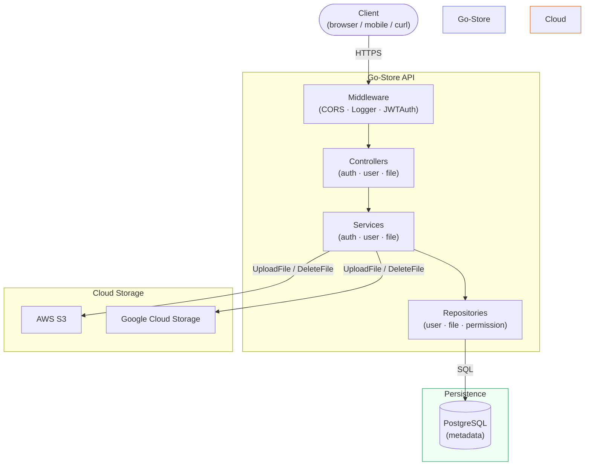

### 2.2 Internal Package Structure

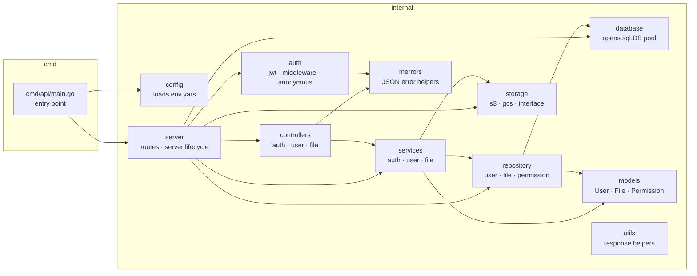

### 2.3 Dependency Injection Chain

Everything is wired in `internal/server/routes.go`. No global singletons, no `init()` side-effects.

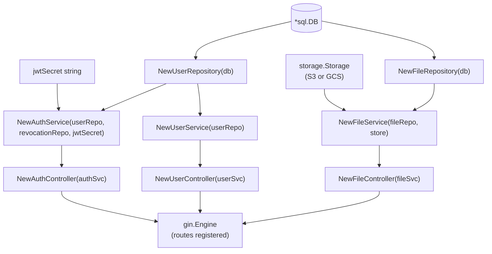

---

## 3. Data Model

### 3.1 Entity-Relationship Diagram

```mermaid
erDiagram
    users {
        varchar_36  id            PK
        varchar_255 username      "UNIQUE NOT NULL"
        varchar_255 email         "UNIQUE NOT NULL"
        varchar_255 password_hash "NOT NULL"
        varchar_20  role          "user | admin; defaults to user"
        bigint      auth_version  "incremented when email/password changes"
        timestamptz created_at
        timestamptz updated_at
    }

    files {
        varchar_36   id           PK
        varchar_255  name         "NOT NULL"
        varchar_1024 path         "private internal object key; never serialized"
        varchar_2048 url          "legacy/internal only; never serialized or used for download"
        bigint       size         "bytes"
        varchar_255  content_type
        varchar_36   owner_id     FK
        varchar_36   folder_id    FK nullable
        char_64      sha256        "content integrity and owner-scoped deduplication"
        varchar_20   state         "active | deleting"
        timestamptz  created_at
        timestamptz  updated_at
    }

    permissions {
        varchar_36 id         PK
        varchar_36 file_id    FK
        varchar_36 user_id    FK
        boolean    can_read
        boolean    can_write
        boolean    can_delete
        timestamptz created_at
        timestamptz updated_at
    }

    folders {
        varchar_36 id PK
        varchar_36 owner_id FK
        varchar_36 parent_id FK nullable
        varchar_255 name
        timestamptz created_at
        timestamptz updated_at
    }

    revoked_tokens {
        char_64 token_hash PK
        timestamptz expires_at
        timestamptz revoked_at
    }

    file_activity {
        bigint id PK
        varchar_36 owner_id FK
        varchar_36 file_id FK nullable
        varchar_255 file_name
        varchar_20 action
        bigint size_bytes
        timestamptz created_at
    }

    upload_reservations {
        varchar_36 id PK
        varchar_36 owner_id FK
        char_64 sha256
        bigint size_bytes
        varchar_1024 object_key
        timestamptz expires_at
    }

    audit_events {
        bigint id PK
        varchar_36 actor_id FK nullable
        varchar_128 actor_subject
        varchar_36 owner_id FK nullable
        varchar_40 resource_type
        varchar_60 action
        varchar_20 outcome
        jsonb details
        timestamptz created_at
    }

    file_delete_jobs {
        varchar_36 id PK
        varchar_36 file_id FK
        varchar_36 owner_id FK
        varchar_1024 object_key
        varchar_128 actor_subject
        integer attempts
    }

    share_links {
        varchar_36 id PK
        char_64 token_hash "raw token returned once"
        varchar_36 file_id FK
        varchar_36 owner_id FK
        varchar_255 password_hash nullable
        timestamptz expires_at
        timestamptz revoked_at nullable
    }

    users ||--o{ files       : "owns"
    users ||--o{ folders     : "owns"
    folders ||--o{ folders   : "contains"
    folders ||--o{ files     : "contains"
    users ||--o{ permissions : "granted"
    files ||--o{ permissions : "governed by"
    users ||--o{ file_activity : "activity for"
    files o|--o{ file_activity : "referenced by"
```

### 3.2 Table Definitions

#### `users`

| Column | Type | Constraints | Notes |
|--------|------|-------------|-------|
| `id` | `VARCHAR(36)` | PK | UUID v4 |
| `username` | `VARCHAR(255)` | NOT NULL, UNIQUE | |
| `email` | `VARCHAR(255)` | NOT NULL, UNIQUE | Indexed |
| `password_hash` | `VARCHAR(255)` | NOT NULL | bcrypt, cost 10 |
| `role` | `VARCHAR(20)` | NOT NULL, DEFAULT 'user' | `user` or `admin` |
| `created_at` | `TIMESTAMPTZ` | NOT NULL, DEFAULT NOW() | |
| `updated_at` | `TIMESTAMPTZ` | NOT NULL, DEFAULT NOW() | |

**Indexes:** `idx_users_email`, `idx_users_username`

#### `files`

| Column | Type | Constraints | Notes |
|--------|------|-------------|-------|
| `id` | `VARCHAR(36)` | PK | UUID v4 |
| `name` | `VARCHAR(255)` | NOT NULL | Original filename |
| `path` | `VARCHAR(1024)` | NOT NULL | Cloud storage object key |
| `url` | `VARCHAR(2048)` | NOT NULL | Public HTTPS URL |
| `size` | `BIGINT` | NOT NULL, DEFAULT 0 | Bytes |
| `content_type` | `VARCHAR(255)` | NOT NULL, DEFAULT '' | MIME type |
| `owner_id` | `VARCHAR(36)` | NOT NULL, FK → users.id | CASCADE DELETE |
| `folder_id` | `VARCHAR(36)` | NULL, FK → folders.id | Folder placement |
| `created_at` | `TIMESTAMPTZ` | NOT NULL, DEFAULT NOW() | |
| `updated_at` | `TIMESTAMPTZ` | NOT NULL, DEFAULT NOW() | |

**Indexes:** `idx_files_owner_id`

#### `permissions`

| Column | Type | Constraints | Notes |
|--------|------|-------------|-------|
| `id` | `VARCHAR(36)` | PK | UUID v4 |
| `file_id` | `VARCHAR(36)` | NOT NULL, FK → files.id | CASCADE DELETE |
| `user_id` | `VARCHAR(36)` | NOT NULL, FK → users.id | CASCADE DELETE |
| `can_read` | `BOOLEAN` | NOT NULL, DEFAULT FALSE | |
| `can_write` | `BOOLEAN` | NOT NULL, DEFAULT FALSE | |
| `can_delete` | `BOOLEAN` | NOT NULL, DEFAULT FALSE | |
| `created_at` | `TIMESTAMPTZ` | NOT NULL, DEFAULT NOW() | |
| `updated_at` | `TIMESTAMPTZ` | NOT NULL, DEFAULT NOW() | |

**Unique constraint:** `(file_id, user_id)` — one permission row per user per file.  
**Indexes:** `idx_permissions_file_id`, `idx_permissions_user_id`

#### `folders`

Folders are owned by users, can have a parent folder, and use per-owner unique names within each directory. Files may be placed in a folder or remain at root.

#### `revoked_tokens`

Stores a `CHAR(64)` SHA-256 fingerprint of each revoked bearer token plus its expiry. Raw JWTs are not persisted; expired fingerprints are pruned opportunistically at logout.

#### `file_activity`

Stores owner-scoped upload, download, and delete events with a filename snapshot, size, and timestamp. Activity writes are best-effort; they do not block file operations. File activity is removed when its owning account is deleted, while file deletion preserves the event and clears its nullable `file_id`.

#### Migration 009: Phase 1 hardening

Migration `009_phase1_core_hardening` is additive; migrations 001–008 are unchanged. It adds `users.auth_version`, file SHA-256/state, upload reservations, actor-aware audit events, durable file-deletion jobs, and expiring/revocable share-link records. Share links persist only a SHA-256 token fingerprint and optional bcrypt password hash; the raw token is returned only at creation. Rollback 009 removes only objects introduced by that migration.

Quota is enforced when reserving uploads. PostgreSQL transactions lock the owner row before summing active file bytes and live reservations, serializing simultaneous uploads per owner. SHA-256 is calculated from uploaded bytes and duplicate detection is scoped to the owner's namespace. Deletion jobs retry storage failures across process restarts.

---

## 4. Authentication & Security

### 4.1 JWT Token Derivation

Go-Store does **not** sign all tokens with the same key. Instead a unique signing key is derived for every token:

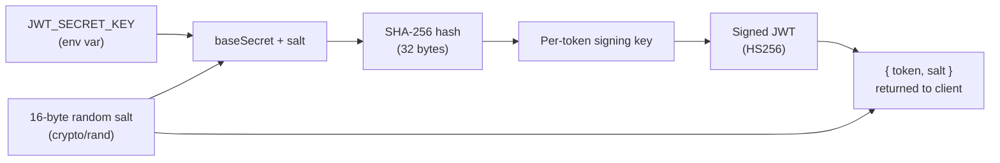

The salt diversifies the derived key per token, but it is not a second authentication factor: a stolen token and salt can still be replayed. Keep `JWT_SECRET_KEY` secret and at least 32 bytes; the server also checks token revocation against PostgreSQL on protected requests.

Tokens expire after **24 hours**. The expiry is embedded in the JWT `exp` claim and enforced during `ValidateToken`.

### 4.2 Request Authentication Flow

Protected routes under `/v1/users`, `/v1/files`, `/v1/folders`, `/v1/shares`, and authenticated logout require two headers:

```
Authorization: Bearer <jwt_token>
X-Salt: <salt>
```

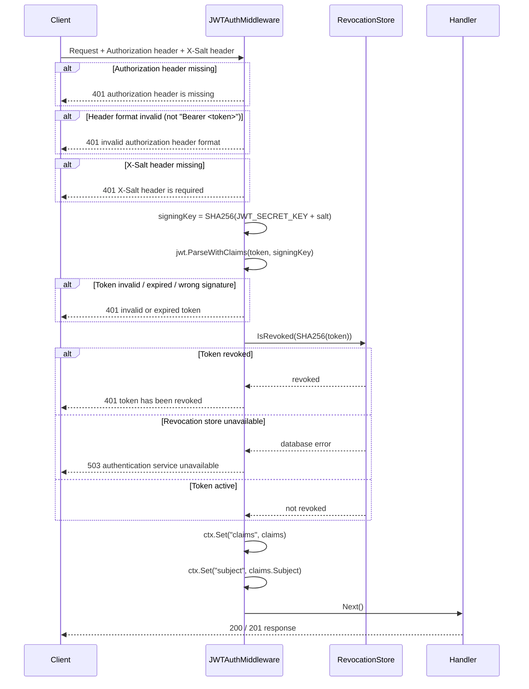

### 4.3 Password Hashing

Passwords are hashed with **bcrypt at cost 10** (`bcrypt.DefaultCost`) inside `models.NewUser` and `models.User.SetPassword`. The plain-text password is never stored, logged, or returned in any JSON response — the `PasswordHash` field is tagged `json:"-"`.

---

## 5. API Reference

### Base URL

```
http://localhost:8080
```

### Authentication Headers (protected routes only)

| Header | Value |
|--------|-------|
| `Authorization` | `Bearer <token>` |
| `X-Salt` | `<salt>` |

Both `token` and `salt` are returned by any login or register endpoint.

---

### 5.1 Auth Endpoints

Registration, login, anonymous registration, and token validation are public. Logout requires the current bearer token and its `X-Salt` header.

#### `POST /v1/auth/oauth/register`

Register a new user account.

**Request body** (`application/json`):

```json
{
  "username": "alice",
  "email": "alice@example.com",
  "password": "s3cur3pass"
}
```

| Field | Type | Constraints |
|-------|------|-------------|
| `username` | string | required |
| `email` | string | required, valid email |
| `password` | string | required, min 8 chars |

**Response `201`:**

```json
{
  "user": {
    "id": "550e8400-e29b-41d4-a716-446655440000",
    "username": "alice",
    "email": "alice@example.com",
    "created_at": "2025-01-01T12:00:00Z",
    "updated_at": "2025-01-01T12:00:00Z"
  },
  "token": "<jwt>",
  "salt": "<base64-salt>"
}
```

**Errors:** `409 Conflict` if email already exists, `422 Unprocessable Entity` on validation failure.

---

#### `POST /v1/auth/oauth/login`

Authenticate an existing user.

**Request body** (`application/json`):

```json
{
  "email": "alice@example.com",
  "password": "s3cur3pass"
}
```

**Response `200`:**

```json
{
  "user": { "id": "...", "username": "alice", "email": "alice@example.com", "..." },
  "token": "<jwt>",
  "salt": "<base64-salt>"
}
```

**Errors:** `401 Unauthorized` on wrong credentials (message is intentionally generic to prevent user enumeration).

---

#### `POST /v1/auth/anonymous/register`

Create a temporary anonymous session. No user record is persisted; the `anonymous_id` is the JWT subject.

**Response `201`:**

```json
{
  "anonymous_id": "anon_550e8400-...",
  "token": "<jwt>",
  "salt": "<base64-salt>"
}
```

---

#### `POST /v1/auth/logout` (authenticated)

Revokes the presented bearer token. The route requires both `Authorization: Bearer <token>` and `X-Salt`. The API stores only the SHA-256 token fingerprint and its expiry in PostgreSQL; protected requests reject revoked tokens.

**Response `200`:**

```json
{ "message": "logged out successfully" }
```

---

#### `POST /v1/auth/validate`

Validate a JWT without a protected resource request. Credentials use `Authorization: Bearer <jwt>` and `X-Salt` headers; tokens and salts are never accepted in query parameters.

No query parameters are accepted for credentials.

**Response `200`:**

```json
{ "subject": "550e8400-...", "valid": true }
```

**Errors:** `401 Unauthorized` if the token is expired or the signature is invalid.

---

### 5.2 User Endpoints

All user endpoints require authentication headers.

#### `POST /v1/users`

Create a new user (admin use-case; regular users register via `/v1/auth/oauth/register`).

**Request body:**

```json
{
  "username": "bob",
  "email": "bob@example.com",
  "password": "password123"
}
```

**Response `201`:** Full user object (password omitted).

---

#### `GET /v1/users/:id`

Fetch a user by UUID.

**Response `200`:**

```json
{
  "data": {
    "id": "...",
    "username": "alice",
    "email": "alice@example.com",
    "created_at": "...",
    "updated_at": "..."
  }
}
```

**Errors:** `404 Not Found`.

---

#### `PUT /v1/users/:id`

Update own profile fields. Every update requires `current_password`. Email/password changes also increment `auth_version`, invalidating prior sessions.

**Request body:**

```json
{
  "username": "alice2",
  "email": "newemail@example.com",
  "password": "newpassword123",
  "current_password": "oldpassword123"
}
```

**Response `200`:** Updated user object.

---

#### `DELETE /v1/users/:id`

Delete the authenticated user's account. Deletion is blocked while files or upload reservations remain, preventing cascades from orphaning stored objects. Delete owned files and wait for the durable storage cleanup worker first. Successful deletion invalidates registered-user tokens because the subject no longer exists.

**Response `200`:**

```json
{ "message": "user deleted successfully" }
```

---

### 5.3 File Endpoints

All file endpoints require authentication headers.

#### `POST /v1/files`

Upload a file to private storage after checking actual bytes, sniffing MIME from content, hashing SHA-256, and reserving per-user quota.

**Request:** `multipart/form-data` with a field named `file`.

```bash
curl -X POST http://localhost:8080/v1/files \
  -H "Authorization: Bearer <token>" \
  -H "X-Salt: <salt>" \
  -F "file=@/path/to/document.pdf"
```

**Response `201` (or `200` for owner-scoped duplicate content):**

```json
{
  "data": {
    "id": "a1b2c3d4-...",
    "name": "document.pdf",
    "size": 204800,
    "content_type": "application/pdf",
    "owner_id": "550e8400-...",
    "created_at": "...",
    "updated_at": "..."
  }
}
```

Responses omit internal storage keys and provider URLs. Identical content in the same owner namespace returns existing metadata without another object upload. A durable quota reservation is finalized with metadata; failed storage/DB operations use cleanup and reservation-recovery paths.

---

#### `GET /v1/files`

List all files owned by the authenticated user. Results are ordered by `created_at DESC`.

**Response `200`:**

```json
{
  "data": [
    { "id": "...", "name": "report.xlsx", "url": "...", "size": 51200, "..." },
    { "id": "...", "name": "photo.jpg",   "url": "...", "size": 819200, "..." }
  ]
}
```

Returns an empty array (not `null`) when the user has no files.

---

#### `GET /v1/files/:id`

Fetch metadata for a single file by UUID.

**Response `200`:** Single file object (same shape as above).  
**Errors:** `404 Not Found`.

---

#### `PUT /v1/files/:id`

Update file metadata. Only the **owner** may update their files.

**Request body:**

```json
{
  "name": "new-filename.pdf",
  "content_type": "application/pdf"
}
```

Both fields are optional. Pass only the fields you want to change.

**Response `200`:** Updated file object.  
**Errors:** `403 Forbidden` if the requester is not the owner, `404 Not Found`.

---

#### `DELETE /v1/files/:id`

Only the owner may permanently delete the canonical file. A recipient's `can_delete` permission never authorizes deletion of the owner's original. The endpoint marks the file deleting and queues a durable storage-cleanup job; a maintenance worker retries failures across process restarts. Recipients may remove only their own shared reference with `DELETE /v1/shares/with-me/:id`.

**Response `202`:**

```json
{ "message": "file deleted successfully" }
```

**Errors:** `403 Forbidden`, `404 Not Found`.

---

### 5.4 Health Check

#### `GET /healthz`

Unauthenticated. Pings the database and returns a generic health status without raw database errors.

**Response `200` (healthy):**

```json
{ "status": "ok" }
```

**Response `503` (database unreachable):**

```json
{ "status": "unhealthy" }
```

---

### 5.5 Error Response Shape

Every error response follows this JSON structure:

```json
{
  "error": {
    "code": 404,
    "type": "not_found",
    "message": "file not found"
  }
}
```

| Status | `type` value | Trigger |
|--------|-------------|---------|
| 400 | `bad_request` | Malformed request, missing required field |
| 401 | `unauthorized` | Missing / invalid / expired JWT |
| 403 | `forbidden` | Authenticated but not the resource owner |
| 404 | `not_found` | Resource does not exist |
| 409 | `conflict` | Duplicate email on register |
| 422 | `validation_error` | Input fails binding validation rules |
| 500 | `internal_server_error` | Unexpected server-side error |
| 503 | `service_unavailable` | Upstream dependency down |
| 550 | `downstream_error` | Third-party integration failure |

---

## 6. Request / Response Flows

### 6.1 Register & Login

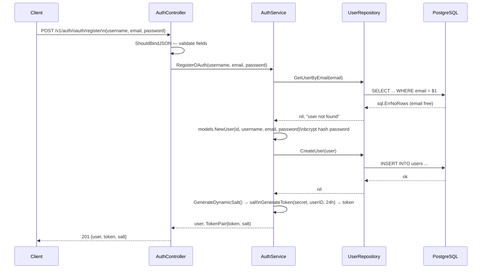

### 6.2 File Upload

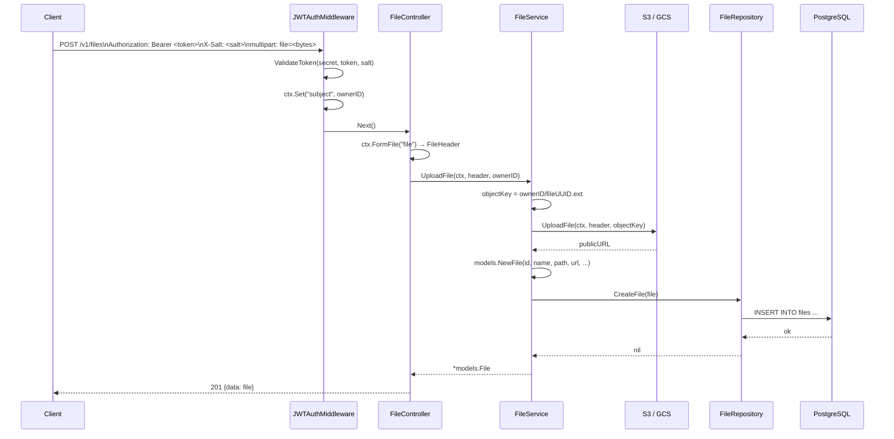

### 6.3 File Delete

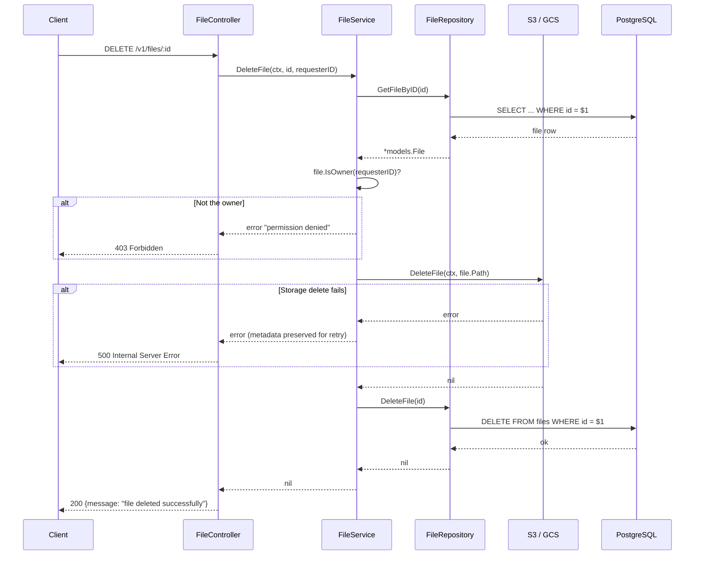

---

## 7. Storage Layer

### 7.1 Storage Interface

Local, S3, and GCS implement the same interface defined in `internal/storage/storage.go`:

```go
type Storage interface {
    UploadFile(ctx context.Context, file *multipart.FileHeader, destination string) (string, error)
    DownloadFile(ctx context.Context, objectKey string) (io.ReadCloser, error)
    DeleteFile(ctx context.Context, objectKey string) error
}
```

The legacy `UploadFile` string return is not used to expose a provider URL. File metadata keeps a private owner/SHA-256 object key hidden from JSON; downloads are streamed through the authorization-checked API. S3/GCS bucket policies must block public reads and adapters do not grant public ACLs.

Switching providers requires only changing `STORAGE_PROVIDER` in your `.env`. No application code changes.

### 7.2 Object Key Convention

```
<owner_id>/<file_uuid><ext>

Example:
  550e8400-e29b-41d4-a716-446655440000/a1b2c3d4-1234-5678-abcd-ef0123456789.pdf
```

This namespaces every user's files at the prefix level, which makes it straightforward to:
- Apply S3 bucket lifecycle rules per user prefix.
- Set GCS IAM conditions scoped to a prefix.
- Calculate per-user storage usage from a prefix listing.

### 7.3 Choosing a Provider

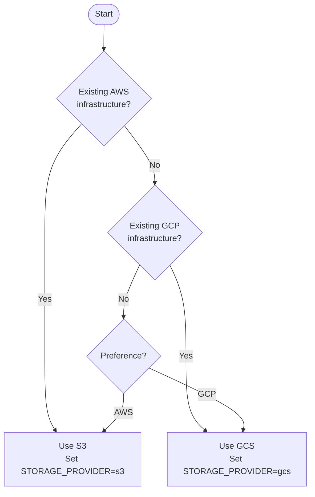

---

## 8. Database

### 8.1 Connection Pool Settings

Set in `internal/database/database.go`:

| Setting | Value | Why |
|---------|-------|-----|
| `MaxOpenConns` | 25 | Caps parallelism; prevents overwhelming the DB |
| `MaxIdleConns` | 25 | Keeps connections warm; avoids reconnect overhead |
| `ConnMaxLifetime` | 5 min | Forces periodic reconnect; handles DB restarts |
| `ConnMaxIdleTime` | 5 min | Returns idle connections to the pool promptly |

After `sql.Open`, the constructor calls `db.Ping()` and returns an error if the database is unreachable — the server fails fast at startup rather than silently serving errors later.

### 8.2 Migration Workflow

Migrations use [golang-migrate](https://github.com/golang-migrate/migrate). Files live in `database/migrations/` and follow the `NNN_description.up.sql` / `NNN_description.down.sql` naming convention.

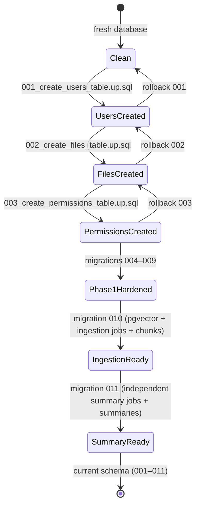

**Commands:**

```bash
# Apply all pending migrations
./scripts/migrate.sh up

# Roll back the last migration
./scripts/migrate.sh rollback

# Drop everything (dev only — destructive)
./scripts/migrate.sh drop
```

---

## 9. Server Lifecycle

### 9.1 Startup Sequence

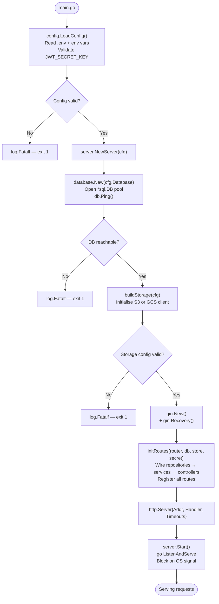

### 9.2 Graceful Shutdown

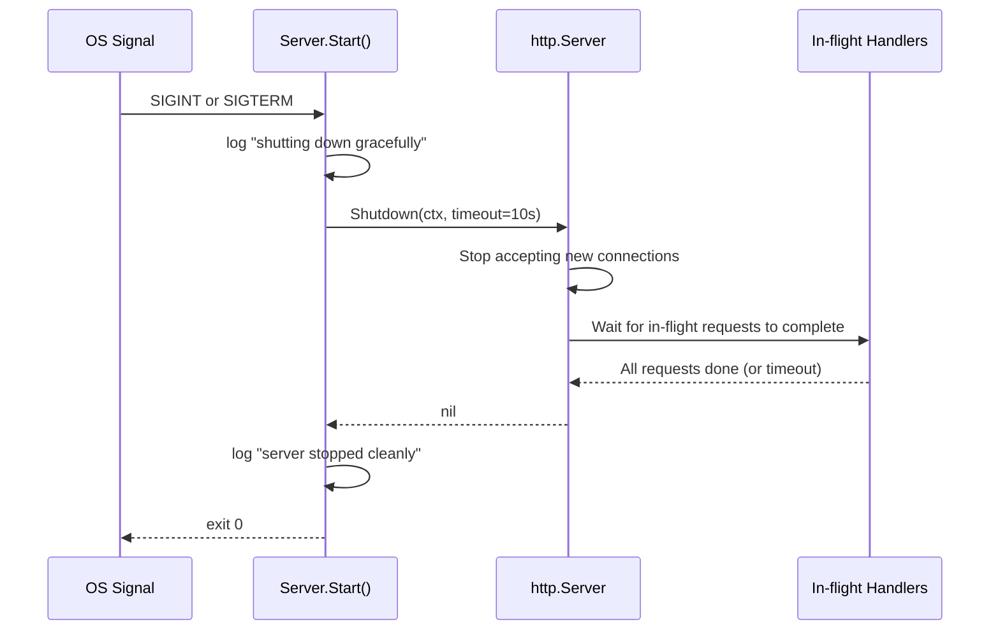

HTTP server timeouts:

| Timeout | Value | Purpose |
|---------|-------|---------|
| `ReadTimeout` | 15 s | Max time to read full request |
| `WriteTimeout` | 15 s | Max time to write full response |
| `IdleTimeout` | 60 s | Max time between keep-alive requests |
| Shutdown | 10 s | Grace period for in-flight requests |

---

## 10. Configuration Reference

Full variable list with defaults and constraints:

| Variable | Required | Default | Description |
|----------|----------|---------|-------------|
| `SERVER_PORT` | No | `8080` | HTTP listen port |
| `APP_ENV` | No | `development` | `development` or `production` |
| `DB_DRIVER` | No | `postgres` | PostgreSQL only; other values fail startup |
| `DB_HOST` | No | `localhost` | Database hostname |
| `DB_PORT` | No | `5432` | Database port |
| `DB_DATABASE` | No | `gostore` | Database name |
| `DB_USERNAME` | No | `postgres` | Database user |
| `DB_PASSWORD` | **Yes** | — | Database password |
| `DB_SSL_MODE` | No | `disable` | `disable`, `require`, `verify-full` |
| `JWT_SECRET_KEY` | **Yes** | — | HMAC base secret, min 32 chars |
| `STORAGE_PROVIDER` | No | `local` | `local`, `s3`, or `gcs` |
| `STORAGE_QUOTA_BYTES` | No | `5368709120` | Enforced per-user quota including reservations |
| `MAX_UPLOAD_BYTES` | No | `52428800` | Actual file-size cap; configurable up to 1 GiB |
| `CORS_ALLOWED_ORIGINS` | No | local Vite origins | Comma-separated exact origins; wildcard rejected |
| `AWS_REGION` | S3 only | `us-east-1` | S3 bucket region |
| `AWS_BUCKET_NAME` | S3 only | — | S3 bucket name |
| `AWS_ACCESS_KEY_ID` | S3 only | — | IAM access key |
| `AWS_SECRET_ACCESS_KEY` | S3 only | — | IAM secret key |
| `GOOGLE_CLOUD_PROJECT_ID` | GCS only | — | GCP project ID |
| `GOOGLE_CLOUD_BUCKET_NAME` | GCS only | — | GCS bucket name |
| `GOOGLE_CLOUD_CREDENTIALS_FILE` | GCS only | — | Path to service account JSON |
| `AI_SERVICE_URL` | No | blank (AI disabled) | Private FastAPI origin used by the Go proxy; blank disables retrieval with a controlled 503 |
| `AI_SHARED_SECRET` | AI profile | — | Shared Go/Python HMAC secret, at least 32 bytes |
| `OLLAMA_EMBED_MODEL` | No | `nomic-embed-text` | Local Ollama embedding model (768 dimensions) |
| `OLLAMA_SUMMARY_MODEL` | No | `llama3.2:3b` | Separate local Ollama generation model for document summaries; never used for embeddings |
| `OLLAMA_BASE_URL` | No | `http://ollama:11434` | Local/private Ollama origin only; public hosted model endpoints are rejected |
| `AI_MAX_DOCUMENT_BYTES` | No | `52428800` | Maximum document bytes read by ingestion |
| `AI_MAX_PDF_PAGES` | No | `250` | Maximum PDF pages processed per file |
| `AI_MAX_OCR_PAGES` | No | `40` | Maximum scanned PDF pages sent to local OCR per file |
| `AI_MAX_EXTRACTED_CHARS` | No | `2500000` | Maximum extracted text characters per file |
| `AI_CHUNK_SIZE` / `AI_CHUNK_OVERLAP` | No | `1200` / `150` | Character-based chunking window and overlap |
| `AI_MAX_ATTEMPTS` / `AI_POLL_SECONDS` | No | `5` / `2` | Retry ceiling and queue polling interval |

---

## 11. Local Development

**Prerequisites:**
- Go 1.21+
- PostgreSQL 14+ with pgvector installed (or the pgvector Compose image)
- Python 3.12+ to run AI-service tests locally
- Docker Compose for the Ollama/FastAPI/worker profile
- `migrate` CLI: `go install -tags 'postgres' github.com/golang-migrate/migrate/v4/cmd/migrate@latest`
- `task` CLI (optional): https://taskfile.dev

```bash
# 1. Clone
git clone https://github.com/souvik03-136/Go-Store.git
cd Go-Store

# 2. Configure
cp .env.example .env
# Edit .env: set DB_PASSWORD and JWT_SECRET_KEY at minimum

# 3. Migrate
./scripts/migrate.sh up

# 4. Run
go run ./cmd/api
# OR
task run

# 5. Optional Python tests (no model or database required for unit tests)
python3 -m venv .venv
.venv/bin/pip install -r ai_service/requirements-dev.txt
.venv/bin/python -m pytest -q ai_service/tests

# 6. Optional local AI stack: set AI_SHARED_SECRET=$(openssl rand -hex 32) in .env first
AI_SERVICE_URL=http://ai-api:8000 docker compose --profile ai up --build
```

**Available `task` commands:**

| Command | Description |
|---------|-------------|
| `task run` | Run the server (reads `.env`) |
| `task build` | Compile to `bin/api` |
| `task test` | Run all tests with race detector |
| `task test:ai` | Run Python AI-service unit tests (install its dev requirements first) |
| `task test:cover` | Tests + HTML coverage report |
| `task lint` | Run `golangci-lint` |
| `task fmt` | Run `gofmt -w .` |
| `task migrate:up` | Apply pending migrations |
| `task migrate:down` | Roll back last migration |
| `task docker:up` | Start Go API and PostgreSQL Compose services |
| `task docker:ai` | Start the local Ollama, AI API, worker, and enable Go retrieval |
| `task docker:down` | Stop Docker Compose stack |
| `task clean` | Remove `bin/` and coverage files |

---

## 12. Docker & Docker Compose

### Dockerfile

The build uses a two-stage Dockerfile:

```mermaid
flowchart LR
    subgraph Stage 1 — builder
        G1["golang:1.21-alpine\n+ ca-certificates + git"]
        G2["go mod download\n(cached layer)"]
        G3["go build -tags netgo\nCGO_ENABLED=0\nStatic binary → bin/api"]
        G1 --> G2 --> G3
    end

    subgraph Stage 2 — runtime
        D1["gcr.io/distroless/static-debian12\n(no shell, no package manager)"]
        D2["COPY bin/api from builder"]
        D3["USER nonroot:nonroot\nEXPOSE 8080\nENTRYPOINT ./api"]
        D1 --> D2 --> D3
    end

    G3 -->|"COPY --from=builder"| D2
```

The final image contains only the static binary and CA certificates — no Go toolchain, no shell, no libc. This minimises the attack surface and image size.

### Docker Compose

`docker-compose.yml` defines PostgreSQL + the Go API by default. PostgreSQL uses the pgvector-enabled
image required by migration 010. The opt-in `ai` profile adds Ollama, a one-time model initializer,
the private FastAPI service, and the worker process that runs independent ingestion and summary
loops. The initializer downloads `OLLAMA_EMBED_MODEL` and `OLLAMA_SUMMARY_MODEL` to the local volume.
AI containers share the Go app's local storage volume read-only.

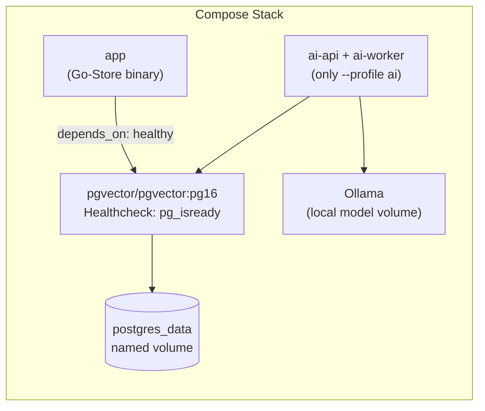

The `app` service uses `depends_on: condition: service_healthy` — it will not start until the Postgres healthcheck (`pg_isready`) passes. This prevents the Go binary from crashing with "connection refused" on a cold start.

```bash
# Start the full stack
docker compose up --build

# Stop and remove containers (data volume is preserved)
docker compose down

# Stop and remove everything including the volume
docker compose down -v
```

---

## 13. Deployment

### Using Docker Compose (recommended)

```bash
# On the target server, with .env populated:
./scripts/deploy.sh
```

`scripts/deploy.sh` will:
1. `git pull origin main`
2. Run `./scripts/migrate.sh up`
3. `docker compose down --remove-orphans`
4. `docker compose build --no-cache`
5. `docker compose up -d`

### Direct binary deployment

```bash
# Build
go build -o bin/api ./cmd/api

# Run (with .env in the working directory)
./bin/api
```

---

## 14. Project File Tree

```
Go-Store/
│
├── cmd/
│   └── api/
│       └── main.go                  Entry point
│
├── internal/
│   ├── auth/
│   │   ├── anonymous.go             GenerateAnonymousID()
│   │   ├── jwt.go                   GenerateToken / ValidateToken
│   │   └── middleware.go            CORS · RequestLogger · JWTAuthMiddleware
│   │
│   ├── config/
│   │   └── config.go                LoadConfig() — reads env vars, validates
│   │
│   ├── controllers/
│   │   ├── auth_controller.go       Register · Login · Anonymous · Logout · Validate
│   │   ├── file_controller.go       Upload · List · Get · Update · Delete
│   │   └── user_controller.go       Create · Get · Update · Delete
│   │
│   ├── database/
│   │   └── database.go              Opens *sql.DB with pool settings
│   │
│   ├── merrors/
│   │   └── merrors.go               BadRequest · Unauthorized · Forbidden ·
│   │                                NotFound · Conflict · Validation ·
│   │                                InternalServer · ServiceUnavailable · Downstream
│   │
│   ├── models/
│   │   ├── file.go                  File struct + NewFile · Rename · IsOwner
│   │   ├── permission.go            Permission struct + helpers
│   │   └── user.go                  User struct + NewUser · CheckPassword · SetPassword
│   │
│   ├── repository/
│   │   ├── file_repository.go       CRUD + ListByOwner
│   │   ├── permission_repository.go CRUD + ListByFile
│   │   └── user_repository.go       CRUD + GetByEmail + GetByUsername
│   │
│   ├── server/
│   │   ├── routes.go                Wires all deps; registers all routes
│   │   └── server.go                NewServer · Start · buildStorage · graceful shutdown
│   │
│   ├── services/
│   │   ├── auth_service.go          RegisterOAuth · LoginOAuth · RegisterAnonymous · ValidateToken
│   │   ├── file_service.go          UploadFile · GetFileByID · ListByOwner · UpdateFile · DeleteFile
│   │   ├── helpers.go               generateID() — UUID helper
│   │   └── user_service.go          CreateUser · GetUserByID · UpdateUser · DeleteUser
│   │
│   ├── storage/
│   │   ├── gcs_storage.go           GCS implementation of Storage interface
│   │   ├── s3_storage.go            S3 implementation of Storage interface
│   │   └── storage.go               Storage interface definition
│   │
│   └── utils/
│       └── response.go              OK() · Created() helpers
│
├── ai_service/
│   ├── api.py                      HMAC-protected local semantic retrieval API
│   ├── worker.py                   Durable ingestion queue, leases, retries, embeddings
│   ├── summary_worker.py           Independent summary queue, retries, lease fencing
│   ├── summarizer.py               Bounded local Ollama map/reduce summarizer
│   ├── extract.py                  Bounded PDF/DOCX/text/OCR extraction and chunking
│   ├── embedder.py                 Local Ollama embedding client
│   └── tests/                      API security, extraction, chunking, path tests
│
├── database/
│   └── migrations/
│       ├── 001–003                  Original schema
│       ├── 004–009                  Additive Phase 1 migrations
│       ├── 010_document_ingestion.* Durable jobs, pgvector chunks, HNSW index
│       └── 011_document_summaries.* Independent summary jobs and stored summaries
│
├── internal/aiclient/              Signed Go-to-FastAPI client
├── internal/controllers/           Semantic search, ingestion, and summary-status handlers
├── internal/repository/            Transactional upload queue + summary/status queries
│
├── scripts/
│   ├── deploy.sh                    Pull · migrate · rebuild · restart
│   └── migrate.sh                   golang-migrate wrapper (up · rollback · drop)
│
├── .env.example                     Environment variable template
├── .gitignore
├── docker-compose.yml               postgres + app services with healthcheck
├── Dockerfile                       Multi-stage build → distroless runtime
├── go.mod
├── README.md
├── sqlc.yaml                        sqlc config (reference; app uses hand-written SQL)
└── Taskfile.yml                     Dev task runner
```


## 15. Phase 2 — Local Document Ingestion, Summaries, and Retrieval

### Components and processing flow

Migration `010_document_ingestion` enables PostgreSQL `vector`, creates the durable `document_ingestion_jobs` queue, and adds `document_chunks` with 768-dimensional embeddings and a cosine HNSW index. It queues existing active files with a non-empty SHA-256 hash. Migration `011_document_summaries` adds independent `document_summary_jobs` and `document_summaries` tables and queues active files that already have ingestion jobs. New upload finalization inserts both job rows atomically with file metadata, activity, and audit records. The canonical digest remains `files.sha256`, introduced by migration 009; no prior migration was rewritten. An owner-scoped content duplicate returns the existing file and does not enqueue duplicate physical content.

The Python 3.12 FastAPI service and worker are under `ai_service/`. The worker polls PostgreSQL using `FOR UPDATE SKIP LOCKED`, records an attempt-number lease, and retries transient failures with capped exponential backoff. Expired leases are reclaimable after a crash; heartbeats and final chunk commits are fenced by the attempt number so a stale worker cannot overwrite a newer attempt. Expired jobs at the retry ceiling become terminal failures. Unsupported/corrupt documents become terminal failures; deleting files cannot remain searchable because retrieval filters active file rows and file deletion cascades jobs/chunks.

The worker mounts local storage read-only, validates that object keys stay under the configured root, requires and verifies the canonical `files.sha256` digest, then extracts text from PDF, DOCX, plain text, Markdown, CSV, JSON, XML, and HTML. Images and scanned PDF pages use the local Tesseract OCR binary. File size, page count, scanned-PDF OCR page count (`AI_MAX_OCR_PAGES`), per-page OCR timeout, image pixels, expanded DOCX size, extracted characters, chunk count, and attempt count are bounded. Text/DOCX/PDF character caps are checked as content is accumulated, not only after the full document has been extracted. Other file formats, including office spreadsheets and presentations, are not ingested in this phase.

Chunk embeddings use the open `nomic-embed-text` model served by the local Ollama container; vectors are stored in pgvector. The first AI-profile startup downloads model weights into the named `ollama_data` volume. No hosted inference endpoint, model API key, or billed AI API is used. A network connection is needed for initial container/model downloads unless the image/model volume is preloaded; subsequent inference runs locally.

### Summary jobs

`SummaryWorker` runs beside ingestion in the existing `ai-worker` container but uses its own PostgreSQL queue, attempt count, lease, retries, and terminal status. It only claims work after the corresponding ingestion job succeeds. It reads the already-extracted page-aware `document_chunks`; it does not re-extract files, change `document_chunks`, or relabel embeddings. A summary failure or local generation-model outage changes only summary state and cannot block semantic-search availability.

`OllamaSummarizer` calls the local Ollama chat endpoint with `OLLAMA_SUMMARY_MODEL`, separate from `OLLAMA_EMBED_MODEL`. It packs page-labelled stored chunks into a conservative character budget, summarizes each segment, then recursively reduces intermediate summaries with bounded segment count, output size, and reduction rounds. The worker holds no database connection during model inference. Final summary text, model identifier, source `files.sha256`, and successful summary-job state are written in one transaction only when the current attempt lease and active-file digest still match. This provides logical source-version fencing, but model inference has not been run against a live Ollama service in this environment.

### API

`GET /v1/files/:id/ingestion` requires JWT authentication and is owner-only. It returns the ingestion state (`queued`, `processing`, `succeeded`, `failed`, or `cancelled`), attempts, a sanitized error code, and update time. It does not return extracted text.

`GET /v1/files/:id/summary` requires JWT authentication and allows the owner or an explicit `can_read` recipient. It returns independent summary-job state and attempts, a sanitized error code, and the completed summary/model when available. Poll this route while queued or processing; a failed summary does not imply failed ingestion.

`POST /v1/search/semantic` accepts a query, optional result limit (1–20), and optional `content_type` MIME prefix such as `image/` or `application/pdf`. The Go API derives the user identity from the authenticated JWT and signs the internal request with `AI_SHARED_SECRET`; FastAPI enforces the HMAC signature and timestamp window. The vector query returns only active files owned by the user or readable through a share grant, and filters to the configured embedding model to avoid mixing incompatible vector spaces. Responses contain matching chunks and similarity scores; this phase does not synthesize an LLM answer. When `AI_SERVICE_URL` is blank, the route returns HTTP 503 with `AI retrieval is not configured`.

The AI API binds only to host loopback (`127.0.0.1:8000`) for local development; it is not exposed on a public interface. The worker and model service have no host ports. The shared HMAC secret is internal-only and must be at least 32 bytes. Do not provide it to the frontend. Health responses are generic and internal service errors are not passed through to users.

### Start and validate

1. Apply migrations through 011 before running the summary-enabled Go app: `./scripts/migrate.sh up`. Existing PostgreSQL installations need the pgvector extension package; the supplied Compose database uses `pgvector/pgvector:pg16`.
2. Generate an internal secret (`openssl rand -hex 32`) and place it in `.env` as `AI_SHARED_SECRET=<generated-value>`. Compose passes the same value to Go, FastAPI and the worker; Go/Python require at least 32 bytes.
3. Start the full local stack with `AI_SERVICE_URL=http://ai-api:8000 docker compose --profile ai up --build`. The default `docker compose up` leaves Ollama/API/worker stopped and leaves Go retrieval disabled. The AI profile downloads both the embedding model (default `nomic-embed-text`) and summary generation model (default `llama3.2:3b`) into the local Ollama volume. With AI disabled, semantic search returns a controlled 503.
4. Run Go tests with `go test -race ./...`; install Python test dependencies with `python3 -m pip install -r ai_service/requirements-dev.txt`, then run `python3 -m pytest -q ai_service/tests` (or `task test:ai`).

Phase 2 ingestion and summarization currently support the local filesystem storage provider only. S3/GCS-backed files are not mounted into the AI worker and their queued jobs will fail rather than being fetched from cloud storage; cloud-provider ingestion requires a future authenticated storage-read transport. The web frontend and generated-answer RAG layer remain design-only. The current schema is migrations 001–011 and uses only `files.sha256` as the source digest.

### Verification snapshot (2026-11-21)

After adding the independent summary queue, this environment passed `go test -race ./...`, `go vet ./...`, `go build ./...`, Python bytecode compilation, **36 Python tests**, Ruff, YAML parsing for Compose/OpenAPI, and `git diff --check`. The new summary tests use an HTTP fake and a fake database; existing in-process ingestion/search tests also use a fake database and do not establish live PostgreSQL behavior.

Live PostgreSQL/pgvector, Docker Compose configuration/runtime, Ollama inference, and Tesseract OCR were not run: Docker is unavailable and no PostgreSQL integration DSN was provided. Compose/OpenAPI YAML parsing is not equivalent to `docker compose config`; migration execution, real `SKIP LOCKED` concurrency, summary lease recovery, and the complete Go-upload-to-pgvector/Ollama flow remain unverified here.


## 16. RAG Chat and Frontend Integration Plan

RAG chat and the React frontend are **not implemented**. The detailed route-by-route frontend plan, current API gaps, and proposed future chat contract are in [`docs/rag-frontend-plan.md`](docs/rag-frontend-plan.md).

For future RAG, keep Go/Gin as the authenticated public boundary, derive the user identity from the JWT rather than browser input, and call the private FastAPI service using the existing timestamp-bound HMAC mechanism. Retrieve only active files owned by the user or explicitly readable through a share grant; client-supplied file IDs may only narrow that scope. Use a local Ollama generation model separate from the embedding model. Build bounded, source-delimited prompts from top-k chunks, answer only from those chunks, abstain clearly when evidence is absent/weak, and validate that citations map to retrieved file/chunk references. Include page numbers only when present in stored metadata. Recheck access on every chat turn so revoked sharing immediately removes access.

Frontend sequencing should follow the existing API: authentication and API client; storage dashboard; upload and ingestion status; file/folder management and application-mediated download; summary polling/read; semantic retrieval-result UI; secure sharing; then chat only after its API, citation, abstention, streaming, rate-limit, and conversation-retention contracts are agreed. Storage analytics exists; AI-usage analytics does not. Never expose `AI_SHARED_SECRET`, raw object keys, provider URLs, or Ollama endpoints to the browser.

The prior API audit also found several pre-existing contract risks documented in the plan: local password auth is currently named under `/oauth/`, share-link revoke should bind the link to the URL's file, analytics error mapping differs from OpenAPI, profile-update validation differs from the spec, and an unregistered user-creation handler should not be treated as a supported route. These are outside this summary/RAG preparation change.
